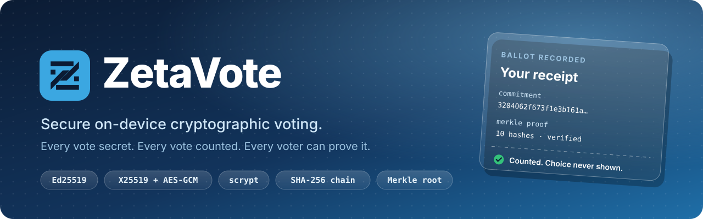
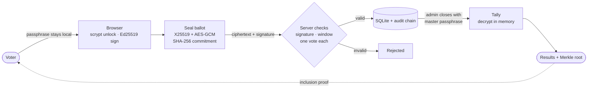
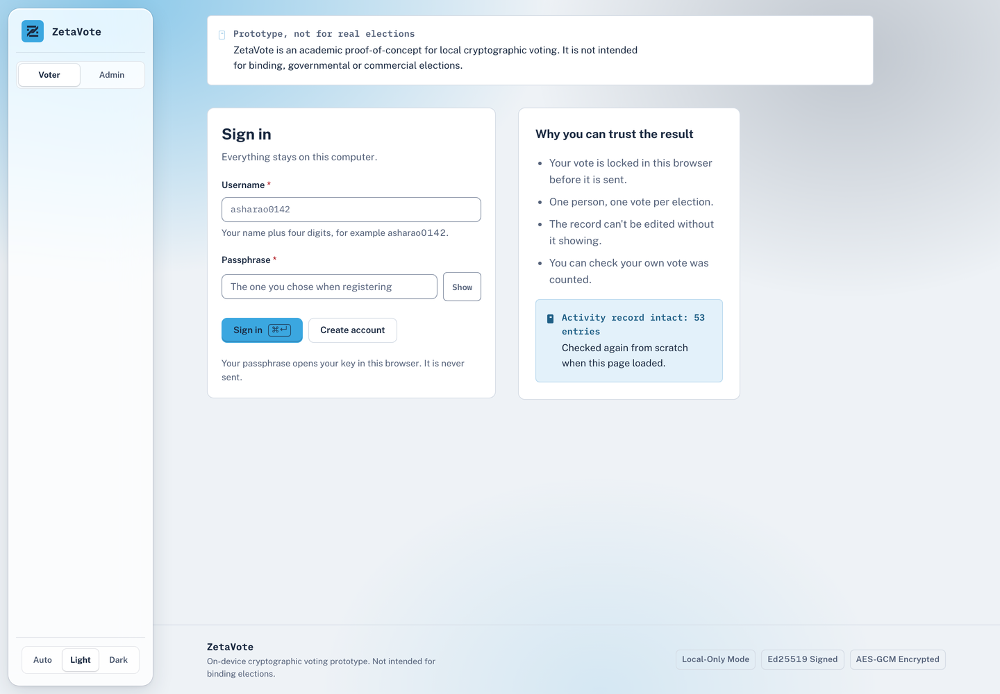
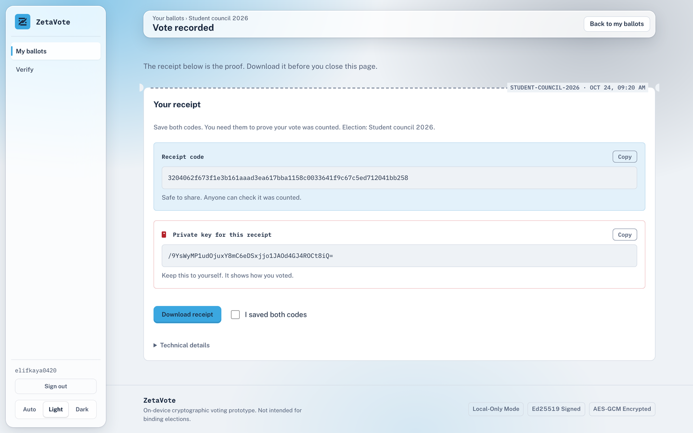
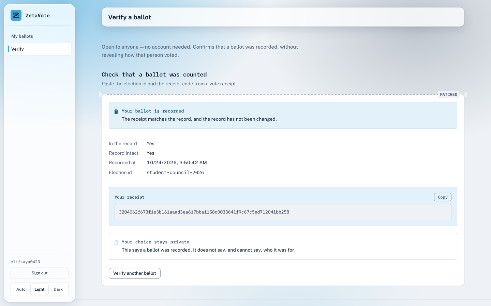
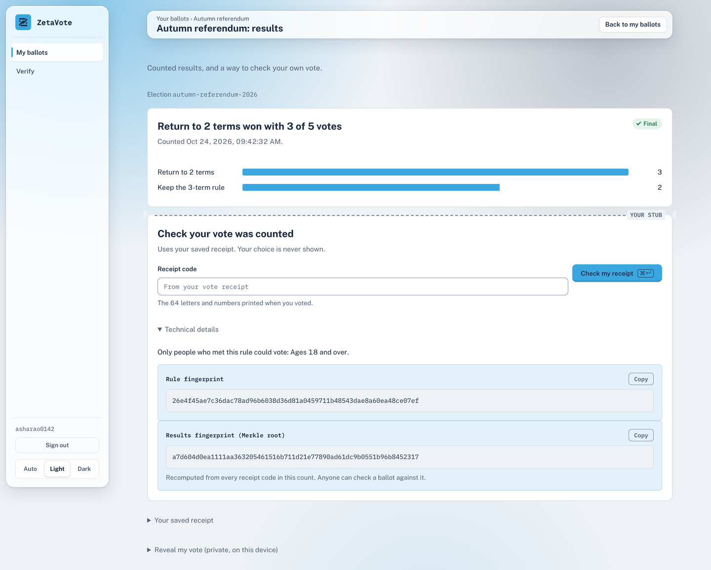

<p align="center">
  
</p>

<p align="center">
  
  
  
  
  
  
</p>

<p align="center">
  <a href="#quick-start">Quick start</a> ·
  <a href="#how-it-works">How it works</a> ·
  <a href="#cryptography">Cryptography</a> ·
  <a href="#screenshots">Screenshots</a> ·
  <a href="#api">API</a> ·
  <a href="#limitations">Limitations</a>
</p>

---

ZetaVote is a voting system that runs entirely on one computer. It uses applied cryptography so that ballots stay secret until the count, nobody can vote twice or forge a ballot, every action leaves a tamper-evident trail, and every voter can check that their own ballot was counted without revealing what they chose.

It is a FastAPI + SQLite backend with a React web client. There are no cloud services and no internet connection is needed.

> [!IMPORTANT]
> ZetaVote is an academic prototype built for a cryptography course. It is not intended for binding, governmental or commercial elections. See [Limitations](#limitations).

## Highlights

| | |
| --- | --- |
| 🔑 **Passphrases never leave the device** | Voters sign in by signing a one-time challenge with an Ed25519 key that is unlocked inside the browser. |
| ✉️ **Ballots sealed in the browser** | Each ballot is encrypted to the election key with X25519 + HKDF + AES-256-GCM before it is sent. The server stores ciphertext only. |
| 🧾 **Receipts that hide the choice** | A salted SHA-256 commitment gives the voter a receipt code that can be checked by anyone but reveals nothing about the vote. |
| ⛓️ **Tamper-evident activity record** | Every ballot, close and count is appended to a SHA-256 hash chain. Editing any line breaks every hash after it. |
| 🌳 **Provable count** | Results are published with a Merkle root over all counted ballots. Voters can request an inclusion proof for their receipt. |
| 🗳️ **Unlinkable across elections** | Each election a voter joins gets a fresh ballot key, so activity in one election cannot be linked to another. |

## Quick start

You need **Python 3.11+** and **Node.js 18+**.

```bash
# 1. Backend dependencies
pip install -r requirements.txt

# 2. Build the web interface (served by the backend)
cd frontend && npm install && npm run build && cd ..

# 3. Create the admin account (first time only)
python run.py --create-admin

# 4. Run
python run.py
```

Open **http://localhost:8080**.

<details>
<summary><b>Development mode (hot reload)</b></summary>

```bash
python run.py                  # backend on 127.0.0.1:8080
cd frontend && npm run dev     # Vite on http://localhost:5173, proxies /api to the backend
```

</details>

<details>
<summary><b>Demo data</b></summary>

With the server stopped and no `data/` folder present:

```bash
python scripts/seed_demo.py
```

This creates one admin, six voters and four elections in every stage (open, closed, counted). Sign-in details are in [DEMO_ACCOUNTS.md](DEMO_ACCOUNTS.md).

</details>

## How it works



1. **Create.** An admin creates an election with candidates, a voting window, an optional age rule and a master passphrase. The server generates the election's X25519 key pair and stores the private key sealed under that passphrase. The passphrase itself is never stored.
2. **Join.** A voter signs a fresh challenge with their account key. The server checks the age rule, and the browser creates a new ballot key pair for this election.
3. **Vote.** The browser commits to the choice with a secret 256-bit salt, encrypts the ballot to the election key, and signs it. The server verifies the signature, the voting window, the timestamp and the one-vote rule, then stores the ballot and appends an audit entry.
4. **Count.** After closing, the admin enters the master passphrase. The server unseals the election key in memory, re-verifies and decrypts every ballot, rejects anything invalid, counts the rest and publishes the totals with a Merkle root.
5. **Verify.** Voters check their receipt code and fetch a Merkle inclusion proof. Anyone can recompute the audit chain.

## Cryptography

The same primitives are implemented twice: [`backend/crypto.py`](backend/crypto.py) (PyCA `cryptography`) and [`frontend/src/services/crypto.ts`](frontend/src/services/crypto.ts) (`@noble/*`). Parity tests pin both to identical bytes.

| Purpose | Primitive | Parameters |
| --- | --- | --- |
| Voter identity and ballot signatures | Ed25519 (RFC 8032) | 32-byte keys, 64-byte signatures |
| Ballot encryption | X25519 (RFC 7748) → HKDF-SHA256 (RFC 5869) → AES-256-GCM | info `zetavote/ballot/v1`, 96-bit nonce, 128-bit tag |
| Sealing private keys | scrypt (RFC 7914) + AES-256-GCM | N = 2¹⁶ (voter), 2¹⁸ (election, admin), r = 8, p = 1, 16-byte salt |
| Receipt commitment | SHA-256 over canonical JSON | `{election_id, voter_pubkey, reveal_salt, choice}`, 256-bit salt |
| Replay key | SHA-256 | `{election_id, voter_pubkey, vote_nonce}`, choice excluded |
| Audit log | SHA-256 hash chain | genesis `SHA256("voting_audit_v1")` |
| Results | SHA-256 Merkle tree | sorted commitments, `SHA256(left \| right)` |

Sessions use a random 32-byte token stored only as a hash, in an `HttpOnly`, `SameSite=Strict` cookie. Login challenges are single-use, last 60 seconds and are bound to one role and account. Failed sign-ins are limited to eight per five minutes.

## Screenshots

<table>
  <tr>
    <td width="50%"><br><sub><b>Sign in.</b> The passphrase unlocks the key in the browser and is never sent.</sub></td>
    <td width="50%"><br><sub><b>Receipt.</b> A public receipt code and a private key, printed on the ballot stub.</sub></td>
  </tr>
  <tr>
    <td width="50%"><br><sub><b>Verify.</b> The receipt is matched to the record without showing the choice.</sub></td>
    <td width="50%"><br><sub><b>Results.</b> Counted totals with the rule fingerprint and Merkle root.</sub></td>
  </tr>
</table>

## API

All routes are under `/api` on `http://localhost:8080`.

| Method | Endpoint | Purpose |
| --- | --- | --- |
| `POST` | `/api/auth/challenge` | Issue a single-use login challenge |
| `POST` | `/api/auth/voter/login` | Verify a signed challenge and start a session |
| `POST` | `/api/auth/admin/login` | Check the admin passphrase against its scrypt verifier |
| `POST` | `/api/accounts` | Create a voter account with its sealed key |
| `GET` `POST` | `/api/elections` | List or create elections |
| `POST` | `/api/elections/{id}/enrol` | Join an election under its eligibility rule |
| `POST` | `/api/elections/{id}/vote` | Submit an encrypted, signed ballot |
| `GET` | `/api/elections/{id}/verify/{commitment}` | Check a receipt without revealing the choice |
| `POST` | `/api/elections/{id}/close` | Close voting (master passphrase) |
| `POST` | `/api/elections/{id}/tally` | Decrypt, count and publish results (master passphrase) |
| `GET` | `/api/elections/{id}/results` | Published totals, rule hash and Merkle root |
| `GET` | `/api/elections/{id}/results/{commitment}/proof` | Merkle inclusion proof for one ballot |
| `GET` | `/api/audit`, `/api/audit/verify` | Read the audit log, recompute the chain |

## Project layout

```text
backend/        FastAPI app, crypto, auth, audit chain, Merkle tree, SQLite schema
frontend/       React 19 + Vite client (pages by role: Admin, Voter, Verify, Login)
tests/          pytest suite, including TypeScript ↔ Python crypto parity vectors
scripts/        demo seeding and browser walkthrough checks
data/           local state: elections.db, keys/, votes_audit.log (not committed)
run.py          starts the server on 127.0.0.1:8080
```

## Testing

```bash
pytest -q
```

273 tests across 17 files cover crypto parity, commitments, voting and replay, the audit chain, tally and verification, authentication, eligibility (including birthdays and leap years), enrolment and input hardening. The suite runs the real API through FastAPI's test client and plays the browser's role, so the full pipeline is exercised rather than mocked.

## Limitations

ZetaVote states its limits plainly:

- **Trust in the key holder.** The server links each ballot to a voter account. Whoever holds the master passphrase could decrypt ballots one by one and match them to voters.
- **No receipt-freeness.** A voter can use the reveal salt to prove how they voted, which would allow vote buying or coercion in a real election.
- **Single server.** One server and one administrator. Threshold decryption across several trustees would remove this single point of trust.
- **Personal data.** The date of birth is stored readable so the age rule can be checked, and nothing stops one person creating two accounts.
- **Local scope.** Built for loopback use only. Not hardened for the internet and not independently audited.

**Future work:** threshold election keys, homomorphic tallying, passkey (FIDO2 / WebAuthn) sign-in, post-quantum signatures and key exchange (ML-DSA / ML-KEM), and an external command-line verifier for the audit chain and Merkle proofs.

## Team

Built at **Symbiosis Artificial Intelligence Institute** for the Cryptography mini project, B.Sc in AI, under the guidance of **Dr. Reema Roychaudhary**.

| Name | PRN |
| --- | --- |
| Sreehari S | 25030421045 |
| Samruddha Dumbhare | 25030421036 |
| Vedant Phand | 25030421048 |

## License

MIT
